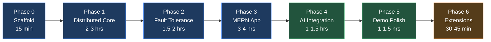

# MeshCompute AI — Executable MVP Build Plan

> **One Job. Multiple Machines. Shared Computing Power.**
>
> This document is a step-by-step, copy-paste-ready build plan for the MeshCompute AI hackathon MVP. Every phase has concrete files to create, commands to run, and acceptance criteria to verify before moving on.

---

## Table of Contents

1. [Pre-Flight Checklist](#1-pre-flight-checklist)
2. [Phase 0 — Monorepo Scaffold & Configuration](#2-phase-0--monorepo-scaffold--configuration)
3. [Phase 1 — Distributed Computing Core (CLI Proof)](#3-phase-1--distributed-computing-core-cli-proof)
4. [Phase 2 — Fault Tolerance & Reliability](#4-phase-2--fault-tolerance--reliability)
5. [Phase 3 — MERN App: Auth, REST API & React Dashboard](#5-phase-3--mern-app-auth-rest-api--react-dashboard)
6. [Phase 4 — AI Integration (Gemini NL → Job Config)](#6-phase-4--ai-integration-gemini-nl--job-config)
7. [Phase 5 — Hackathon Demo Polish](#7-phase-5--hackathon-demo-polish)
8. [Phase 6 — Extension Points (Post-Demo)](#8-phase-6--extension-points-post-demo)
9. [Risk Matrix & Contingency](#9-risk-matrix--contingency)
10. [Demo Day Runbook](#10-demo-day-runbook)

---

## 1. Pre-Flight Checklist

> [!IMPORTANT]
> Complete every item here before writing a single line of project code.

| # | Item | Command / Action | Done? |
|---|------|------------------|-------|
| 1 | **Node.js ≥ 20** installed | `node -v` → should show `v20.x` or higher | ☐ |
| 2 | **npm ≥ 9** installed | `npm -v` | ☐ |
| 3 | **MongoDB** running locally or Atlas URI ready | `mongosh --eval "db.runCommand({ping:1})"` or copy Atlas connection string | ☐ |
| 4 | **Gemini API key** obtained | [Google AI Studio](https://aistudio.google.com/apikey) → copy key | ☐ |
| 5 | **Git** initialized | `git init` in project root | ☐ |
| 6 | **Two+ machines** available on same network (or mobile hotspot) for cross-machine demo | Test with `ping <other-machine-ip>` | ☐ |
| 7 | **Fallback plan**: All workers can run on one laptop | Confirmed | ☐ |

---

## 2. Phase 0 — Monorepo Scaffold & Configuration

**Goal:** Empty but fully wired monorepo. No logic yet — just folders, `package.json` files, env templates, and placeholder entry points that start without errors.

**Estimated time:** 15–20 minutes

### 2.1 Create directory structure

```
meshcompute/
├── package.json              ← npm workspaces root
├── .env.example
├── .gitignore
├── README.md
├── shared/
│   ├── package.json
│   └── constants.js          ← event names, task types, statuses, limits
├── coordinator/
│   ├── package.json
│   └── src/
│       ├── index.js
│       ├── config.js
│       ├── models/
│       │   ├── User.js
│       │   ├── Worker.js
│       │   ├── Job.js
│       │   └── Task.js
│       ├── routes/
│       │   ├── auth.js
│       │   ├── workers.js
│       │   └── jobs.js
│       ├── sockets/
│       │   ├── workerNamespace.js
│       │   └── dashboardNamespace.js
│       ├── services/
│       │   ├── jobSplitter.js
│       │   ├── scheduler.js
│       │   ├── heartbeatMonitor.js
│       │   ├── aggregator.js
│       │   ├── aiInterpreter.js
│       │   └── baselineRunner.js
│       └── middleware/
│           ├── auth.js
│           └── error.js
├── worker-agent/
│   ├── package.json
│   └── src/
│       ├── index.js
│       ├── taskRunner.js
│       ├── tasks/
│       │   └── montecarloPi.js
│       └── sysinfo.js
└── frontend/
    ├── package.json
    └── src/
        ├── main.jsx
        ├── App.jsx
        ├── pages/
        │   ├── Login.jsx
        │   ├── Dashboard.jsx
        │   ├── Workers.jsx
        │   ├── NewJob.jsx
        │   ├── JobDetail.jsx
        │   └── History.jsx
        ├── components/
        ├── store/
        │   ├── useAuthStore.js
        │   ├── useWorkerStore.js
        │   └── useJobStore.js
        └── lib/
            ├── socket.js
            └── api.js
```

### 2.2 Root `package.json`

```json
{
  "name": "meshcompute",
  "private": true,
  "type": "module",
  "workspaces": ["shared", "coordinator", "worker-agent", "frontend"],
  "scripts": {
    "dev:coordinator": "npm -w coordinator run dev",
    "dev:frontend": "npm -w frontend run dev",
    "worker": "npm -w worker-agent run start",
    "test": "npm -w coordinator run test"
  }
}
```

### 2.3 `.env.example`

```env
# Coordinator
PORT=4000
MONGODB_URI=mongodb://localhost:27017/meshcompute
JWT_SECRET=change-this-to-a-random-string
GEMINI_API_KEY=your-gemini-api-key
HEARTBEAT_INTERVAL_MS=3000
HEARTBEAT_TIMEOUT_MS=10000
TASK_TIMEOUT_MS=60000
MAX_SAMPLES_PER_JOB=2000000000
MAX_ATTEMPTS=3

# Worker
COORDINATOR_URL=http://localhost:4000
WORKER_TOKEN=copy-from-dashboard-after-registration
WORKER_NAME=worker-1
MAX_CORES=4
MAX_CONCURRENT_TASKS=4
```

### 2.4 `shared/constants.js` — Full event & constant definitions

```js
// === Task Types (whitelist) ===
export const TASK_TYPES = { MONTE_CARLO_PI: 'MONTE_CARLO_PI' };

// === Statuses ===
export const WORKER_STATUS = { ONLINE: 'online', BUSY: 'busy', OFFLINE: 'offline' };
export const JOB_STATUS    = { PENDING: 'pending', RUNNING: 'running', COMPLETED: 'completed', FAILED: 'failed', CANCELLED: 'cancelled' };
export const TASK_STATUS   = { PENDING: 'pending', ASSIGNED: 'assigned', RUNNING: 'running', COMPLETED: 'completed', FAILED: 'failed' };

// === Socket Events: Worker ↔ Coordinator ===
export const WS_EVENTS = {
  WORKER_REGISTER:   'worker:register',
  WORKER_REGISTERED: 'worker:registered',
  WORKER_HEARTBEAT:  'worker:heartbeat',
  TASK_ASSIGN:       'task:assign',
  TASK_STARTED:      'task:started',
  TASK_RESULT:       'task:result',
  TASK_ERROR:        'task:error',
  TASK_CANCEL:       'task:cancel',
};

// === Socket Events: Coordinator → Dashboard ===
export const DASH_EVENTS = {
  WORKER_UPDATE: 'worker:update',
  JOB_UPDATE:    'job:update',
  TASK_UPDATE:   'task:update',
};

// === Limits ===
export const LIMITS = {
  MAX_SAMPLES_PER_JOB:  2_000_000_000,
  MAX_CHUNK_SIZE:        50_000_000,
  MIN_CHUNK_SIZE:        10_000,
  DEFAULT_CHUNK_SIZE:    5_000_000,
  MAX_ATTEMPTS:          3,
  HEARTBEAT_INTERVAL_MS: 3000,
  HEARTBEAT_TIMEOUT_MS:  10000,
};
```

### 2.5 Install dependencies

```bash
# Root
npm init -y  # then edit to match 2.2

# Coordinator
cd coordinator && npm init -y
npm install express socket.io mongoose jsonwebtoken bcryptjs zod dotenv cors
npm install -D vitest supertest nodemon

# Worker Agent
cd ../worker-agent && npm init -y
npm install socket.io-client dotenv uuid

# Frontend
cd ../frontend
npm create vite@latest . -- --template react
npm install tailwindcss @tailwindcss/vite zustand recharts socket.io-client axios react-router-dom
```

### 2.6 Acceptance criteria

| Check | How to verify |
|-------|---------------|
| `npm install` from root succeeds | No errors |
| `npm run dev:coordinator` starts Express on port 4000 | Terminal: `Server listening on 4000` |
| `npm run dev:frontend` starts Vite dev server | Terminal: `Local: http://localhost:5173` |
| All placeholder files exist at their paths | `find . -name "*.js" -o -name "*.jsx"` lists every file above |

```bash
git add -A && git commit -m "Phase 0: monorepo scaffold"
```

---

## 3. Phase 1 — Distributed Computing Core (CLI Proof)

**Goal:** Coordinator splits a Monte Carlo Pi job into tasks, distributes them to 3 workers via Socket.IO, collects results, aggregates Pi. No frontend, no auth — just a working distributed compute pipeline.

**Estimated time:** 2–3 hours

### 3.1 Files to implement (in order)

| # | File | What it does |
|---|------|-------------|
| 1 | `shared/constants.js` | Already done in Phase 0 |
| 2 | `coordinator/src/config.js` | Load `.env`, export config object |
| 3 | `coordinator/src/models/Job.js` | Mongoose schema (no User ref yet — use a placeholder `owner`) |
| 4 | `coordinator/src/models/Task.js` | Mongoose schema |
| 5 | `coordinator/src/models/Worker.js` | Mongoose schema (no `owner` ref yet) |
| 6 | `coordinator/src/services/jobSplitter.js` | Takes `{ type, params: { totalSamples, chunkSize } }`, creates N Task docs with deterministic seeds |
| 7 | `coordinator/src/services/scheduler.js` | Finds pending tasks, assigns to workers with free capacity, emits `task:assign` |
| 8 | `coordinator/src/services/aggregator.js` | When all tasks for a job are `completed`, compute `pi = 4 * sum(inside) / sum(total)`, update Job |
| 9 | `coordinator/src/sockets/workerNamespace.js` | Handle `worker:register`, `worker:heartbeat`, `task:started`, `task:result`, `task:error` |
| 10 | `coordinator/src/index.js` | Express + Socket.IO bootstrap, MongoDB connect, mount `/workers` namespace |
| 11 | `worker-agent/src/sysinfo.js` | Return `{ cpuCores, totalRamMB, platform }` using `os` module |
| 12 | `worker-agent/src/tasks/montecarloPi.js` | Pure function: seeded PRNG (mulberry32), `{ inside, total }` — runs inside `worker_thread` |
| 13 | `worker-agent/src/taskRunner.js` | `worker_threads` pool, dispatch by task type, return result |
| 14 | `worker-agent/src/index.js` | Connect to coordinator, register, heartbeat loop, handle `task:assign`, emit results |

### 3.2 Key implementation details

#### Seeded PRNG (mulberry32)

```js
// worker-agent/src/tasks/montecarloPi.js
function mulberry32(seed) {
  return function () {
    seed |= 0; seed = (seed + 0x6D2B79F5) | 0;
    let t = Math.imul(seed ^ (seed >>> 15), 1 | seed);
    t = (t + Math.imul(t ^ (t >>> 7), 61 | t)) ^ t;
    return ((t ^ (t >>> 14)) >>> 0) / 4294967296;
  };
}

export function montecarloPi({ samples, seed }) {
  const rng = mulberry32(seed);
  let inside = 0;
  for (let i = 0; i < samples; i++) {
    const x = rng(), y = rng();
    if (x * x + y * y <= 1) inside++;
  }
  return { inside, total: samples };
}
```

#### Job splitter seed generation

```js
// Each task gets seed = hash(jobId + taskIndex) to be deterministic
function deterministicSeed(jobId, index) {
  let hash = 0;
  const str = `${jobId}-${index}`;
  for (let i = 0; i < str.length; i++) {
    hash = ((hash << 5) - hash + str.charCodeAt(i)) | 0;
  }
  return hash >>> 0; // unsigned 32-bit
}
```

#### Scheduler logic (rule-based)

```
1. Query all tasks with status=pending for running jobs
2. Query all workers with status=online
3. For each worker, compute freeSlots = maxConcurrentTasks - activeTasks
4. Sort workers by freeSlots DESC, then cpuLoad ASC
5. Assign tasks to workers with freeSlots > 0
6. Emit task:assign to the worker's socket, set task status=assigned
7. Trigger on: job created, task completed, worker joined, worker lost
```

### 3.3 Temporary test harness

Create `coordinator/src/scripts/submitJob.js`:

```js
// Usage: node coordinator/src/scripts/submitJob.js --samples 100000000 --chunk 5000000
// Connects to MongoDB, creates a Job, splits into Tasks, and polls for completion
```

### 3.4 Unit tests to write

| Test file | Cases |
|-----------|-------|
| `coordinator/tests/jobSplitter.test.js` | Correct task count, samples sum to total, all seeds unique, handles non-even division |
| `coordinator/tests/aggregator.test.js` | Correct pi from known inside/total values |
| `worker-agent/tests/montecarloPi.test.js` | Same seed → same result (reproducibility), estimate within ±0.01 of π for 1M samples |

### 3.5 Acceptance criteria

```
✅ Start coordinator:       npm run dev:coordinator
✅ Start 3 workers:         WORKER_NAME=w1 npm run worker
                            WORKER_NAME=w2 npm run worker
                            WORKER_NAME=w3 npm run worker
✅ Submit job:              npm run submit-job -- --samples 100000000 --chunk 5000000
✅ Terminal output shows:
   - "20 tasks created"
   - Tasks assigned across all 3 workers
   - Per-task results streaming in
   - Final: "Pi ≈ 3.14159... (20 tasks, 100M samples)"
✅ Unit tests pass:         npm test
```

```bash
git add -A && git commit -m "Phase 1: distributed computing core with Monte Carlo Pi"
```

---

## 4. Phase 2 — Fault Tolerance & Reliability

**Goal:** Workers can die, reconnect, send late results — and the system handles it all correctly. No data corruption, no double-counting.

**Estimated time:** 1.5–2 hours

### 4.1 Files to implement / modify

| # | File | Changes |
|---|------|---------|
| 1 | `coordinator/src/services/heartbeatMonitor.js` | **New.** `setInterval` every 3s: mark workers with `lastHeartbeat > 10s ago` as `offline`, requeue their tasks |
| 2 | `coordinator/src/sockets/workerNamespace.js` | **Modify.** On `disconnect`: mark worker offline, requeue tasks. On `worker:register` with existing `workerId`: reconnect flow |
| 3 | `coordinator/src/services/scheduler.js` | **Modify.** On requeue, increment `attempt`, push to `task.history[]` |
| 4 | `coordinator/src/sockets/workerNamespace.js` (task:result handler) | **Modify.** Reject if `task.status === 'completed'` OR `payload.attempt !== task.attempt`. Validate `0 <= inside <= total` and `total === task.params.samples` |
| 5 | `coordinator/src/index.js` | **Modify.** Start heartbeat monitor interval. Add per-task timeout: if a task stays `assigned`/`running` longer than `TASK_TIMEOUT_MS`, requeue it |
| 6 | `worker-agent/src/index.js` | **Modify.** Persist `workerId` to `.worker-id` file. On reconnect, re-register with same ID |

### 4.2 Requeue logic (pseudocode)

```
function requeueTasksForWorker(workerId):
  tasks = find Tasks where assignedTo=workerId AND status in [assigned, running]
  for each task:
    if task.attempt >= MAX_ATTEMPTS:
      task.status = 'failed'
      task.history.push({ worker: workerId, attempt: task.attempt, outcome: 'worker_lost', at: now })
      mark parent Job as 'failed' with reason
    else:
      task.status = 'pending'
      task.attempt += 1
      task.assignedTo = null
      task.history.push({ worker: workerId, attempt: task.attempt - 1, outcome: 'worker_lost', at: now })
  trigger scheduler
```

### 4.3 Duplicate-result protection

```
on task:result({ taskId, attempt, result }):
  task = findById(taskId)
  if task.status === 'completed':
    log("Ignoring late result for already-completed task")
    return
  if attempt !== task.attempt:
    log("Ignoring stale attempt result")
    return
  // validate and accept
```

### 4.4 Tests to write

| Test file | Cases |
|-----------|-------|
| `coordinator/tests/heartbeatMonitor.test.js` | Worker with old heartbeat → marked offline |
| `coordinator/tests/faultTolerance.test.js` | Worker disconnect → tasks requeued with attempt+1, late result ignored, invalid result rejected, max attempts → job failed |

### 4.5 Acceptance criteria

```
✅ Start coordinator + 3 workers
✅ Submit a long job: --samples 500000000 --chunk 5000000 (100 tasks)
✅ While tasks are running, kill worker w2 (Ctrl+C)
✅ Terminal shows:
   - "Worker w2 disconnected, marking offline"
   - "Requeuing 4 tasks from worker w2 (attempt 2)"
   - Tasks picked up by w1 and w3
   - Job completes with correct Pi and correct total sample count
✅ Task history in DB shows reassignment entries
✅ No double-counted samples (sum of completed task totals === totalSamples)
✅ Restart w2 → it reconnects with same workerId, gets new tasks
```

```bash
git add -A && git commit -m "Phase 2: fault tolerance — heartbeats, requeue, duplicate protection"
```

---

## 5. Phase 3 — MERN App: Auth, REST API & React Dashboard

**Goal:** Full web application. Users register, see workers, submit jobs from a form, watch live progress, see results and benchmarks — all in a polished dark-themed UI.

**Estimated time:** 3–4 hours

### 5.1 Backend: Auth & REST

| # | File | What to implement |
|---|------|-------------------|
| 1 | `coordinator/src/models/User.js` | Schema: `email`, `passwordHash`, `name`, `role` (consumer/provider/both), `workerToken` (auto-generated UUID), `createdAt` |
| 2 | `coordinator/src/middleware/auth.js` | JWT verification middleware: extract token from `Authorization: Bearer <token>`, verify, attach `req.user` |
| 3 | `coordinator/src/middleware/error.js` | Global error handler with consistent JSON responses |
| 4 | `coordinator/src/routes/auth.js` | `POST /api/auth/register` — hash password, create user, return JWT. `POST /api/auth/login` — verify password, return JWT. `GET /api/auth/me` — return user profile including `workerToken` |
| 5 | `coordinator/src/routes/workers.js` | `GET /api/workers` — list workers with live stats (auth required) |
| 6 | `coordinator/src/routes/jobs.js` | `POST /api/jobs` — create job from config. `GET /api/jobs` — list user's jobs. `GET /api/jobs/:id` — job detail with tasks. `POST /api/jobs/:id/cancel` — cancel. `POST /api/jobs/:id/baseline` — run baseline |
| 7 | `coordinator/src/services/baselineRunner.js` | Run the same Monte Carlo code for `totalSamples` on one machine (single thread), return `{ durationMs, piEstimate }` |
| 8 | `coordinator/src/sockets/dashboardNamespace.js` | Authenticate via JWT in handshake, join room. Emit `worker:update`, `job:update`, `task:update` events |
| 9 | `coordinator/src/sockets/workerNamespace.js` | **Modify.** Authenticate via `workerToken` in handshake auth, link worker to owner User |
| 10 | `coordinator/src/index.js` | **Modify.** Mount auth, workers, jobs routes. Mount dashboard namespace. Add CORS for frontend origin |

### 5.2 Frontend: Pages & Components

| # | Page / Component | Key elements |
|---|------------------|-------------|
| 1 | **`Login.jsx`** | Email + password form, register/login toggle, error display |
| 2 | **`Dashboard.jsx`** | Summary cards: total workers (online/offline), active jobs, completed jobs. Worker mini-cards with live CPU/RAM bars |
| 3 | **`Workers.jsx`** | Table: name, platform, cores, RAM, CPU load (live), free RAM (live), status badge (green/yellow/red), tasks completed. Copy `workerToken` button |
| 4 | **`NewJob.jsx`** | Manual form: `totalSamples` (number input with presets: 10M, 100M, 500M, 1B), `chunkSize` (with smart default). Run button. (NL box added in Phase 4) |
| 5 | **`JobDetail.jsx`** | Progress bar (completedTasks / totalTasks), live partial Pi estimate, per-task table (index, worker, status, attempt, computeMs), final result box, "Run Baseline" button, Recharts bar chart (baseline vs distributed time + speedup label) |
| 6 | **`History.jsx`** | Table of past jobs: type, samples, status, duration, Pi estimate, date. Click to go to detail |

### 5.3 Zustand stores

```js
// useAuthStore.js
{ user, token, login(), register(), logout(), fetchMe() }

// useWorkerStore.js
{ workers: Map<workerId, worker>, setWorker(), removeWorker() }
// Updated by socket worker:update events

// useJobStore.js
{ jobs: Map<jobId, job>, currentJob, setJob(), updateJobProgress() }
// Updated by socket job:update and task:update events
```

### 5.4 Socket.IO client setup

```js
// frontend/src/lib/socket.js
import { io } from 'socket.io-client';

export function connectDashboard(token) {
  return io('http://localhost:4000/dashboard', {
    auth: { token },
    transports: ['websocket'],
  });
}
```

### 5.5 UI design guidelines

- **Dark theme** with Tailwind: `bg-gray-950` base, `bg-gray-900` cards, `bg-gray-800` inputs
- **Accent color**: Electric blue (`blue-500`) for primary actions, green for success, red for errors
- **Status badges**: Green dot = online, Yellow dot = busy, Red dot = offline
- **Progress bar**: Animated with percentage and task count
- **Responsive**: Works on both laptop screens for demo

### 5.6 Baseline comparison chart

```jsx
// Recharts BarChart in JobDetail.jsx
<BarChart data={[
  { name: 'Single Machine', time: job.baseline.durationMs / 1000 },
  { name: 'Distributed', time: job.timing.durationMs / 1000 },
]}>
  <Bar dataKey="time" />
</BarChart>
// Below chart: "Speedup: {(baseline / distributed).toFixed(1)}x"
```

### 5.7 Acceptance criteria

```
✅ Register a new user via the UI
✅ Copy the workerToken from the profile/workers page
✅ Start 2 workers with that token:
   WORKER_TOKEN=<token> WORKER_NAME=w1 npm run worker
   WORKER_TOKEN=<token> WORKER_NAME=w2 npm run worker
✅ Workers appear on the Workers page with live CPU/RAM
✅ Submit a job (100M samples, 5M chunk) from the New Job page
✅ Watch live progress bar advance on JobDetail page
✅ Kill one worker → status goes red, tasks reassign, job still completes
✅ Click "Run Baseline" → chart shows distributed vs single-machine times
✅ Speedup > 1x for a large enough job
✅ History page shows the completed job
```

```bash
git add -A && git commit -m "Phase 3: MERN app — auth, REST API, React dashboard with live updates"
```

---

## 6. Phase 4 — AI Integration (Gemini NL → Job Config)

**Goal:** Users type natural language ("Estimate pi with half a billion samples"), Gemini returns a structured job config, user confirms, job runs.

**Estimated time:** 1–1.5 hours

### 6.1 Files to implement / modify

| # | File | What to implement |
|---|------|-------------------|
| 1 | `coordinator/src/services/aiInterpreter.js` | **Core AI service.** Calls Gemini API with a system prompt + user prompt, requests JSON-only output. Validates with Zod. Falls back to regex parser |
| 2 | `coordinator/src/routes/jobs.js` | **Modify.** Add `POST /api/jobs/interpret` route |
| 3 | `frontend/src/pages/NewJob.jsx` | **Modify.** Add NL textarea + "Interpret with AI" button + editable config preview + explanation display |
| 4 | `coordinator/src/models/Job.js` | **Modify.** Ensure `rawPrompt` and `aiConfig` fields are stored |

### 6.2 Gemini prompt design

```js
const systemPrompt = `You are a job configuration assistant for MeshCompute, a distributed computing platform.
The user will describe a computational job in natural language.
Return ONLY valid JSON with this exact structure:
{
  "type": "MONTE_CARLO_PI",
  "params": { "totalSamples": <number>, "chunkSize": <number> },
  "explanation": "<one sentence explaining the config>"
}

Rules:
- type MUST be "MONTE_CARLO_PI" (the only supported type)
- totalSamples: minimum 100000, maximum 2000000000
- chunkSize: minimum 10000, maximum 50000000. Default to totalSamples/100 or 5000000, whichever is smaller
- Parse human numbers: "half a billion" = 500000000, "10 million" = 10000000, "1b" = 1000000000
- If the request is unclear, make reasonable defaults and explain in the explanation field`;
```

### 6.3 Zod validation schema

```js
import { z } from 'zod';
import { TASK_TYPES, LIMITS } from 'meshcompute-shared/constants.js';

const jobConfigSchema = z.object({
  type: z.enum([TASK_TYPES.MONTE_CARLO_PI]),
  params: z.object({
    totalSamples: z.number().int().min(100_000).max(LIMITS.MAX_SAMPLES_PER_JOB),
    chunkSize: z.number().int().min(LIMITS.MIN_CHUNK_SIZE).max(LIMITS.MAX_CHUNK_SIZE),
  }),
  explanation: z.string().optional(),
});
```

### 6.4 Regex fallback parser

```js
// Handles: "500 million", "500M", "500_000_000", "5e8", "half a billion", "2b"
function regexParseSamples(prompt) {
  const multipliers = { k: 1e3, m: 1e6, b: 1e9, million: 1e6, billion: 1e9, thousand: 1e3 };
  const wordNumbers = { 'half a billion': 5e8, 'quarter billion': 2.5e8 };
  // ... pattern matching logic
  // Returns { type: 'MONTE_CARLO_PI', params: { totalSamples, chunkSize }, explanation, fallback: true }
}
```

### 6.5 UI flow

```
┌─────────────────────────────────────────────────────┐
│  New Job                                            │
│                                                     │
│  ┌───────────────────────────────────────────────┐  │
│  │ "Estimate pi using half a billion samples,    │  │
│  │  split into chunks of 10 million"             │  │
│  └───────────────────────────────────────────────┘  │
│                                                     │
│  [ 🤖 Interpret with AI ]    [ Manual Form ▾ ]      │
│                                                     │
│  ┌─ AI Config Preview ─────────────────────────┐    │
│  │  Type: MONTE_CARLO_PI                       │    │
│  │  Total Samples: 500,000,000  [editable]     │    │
│  │  Chunk Size:    10,000,000   [editable]     │    │
│  │  Tasks: 50                                  │    │
│  │                                             │    │
│  │  💡 "Pi estimation using 500M random         │    │
│  │     samples split into 50 tasks"            │    │
│  │                                             │    │
│  │  ⚠ AI-generated config. Review before       │    │
│  │    running.                  [used fallback] │    │
│  └─────────────────────────────────────────────┘    │
│                                                     │
│  [ ▶ Run Job ]                                      │
└─────────────────────────────────────────────────────┘
```

### 6.6 Tests

| Test file | Cases |
|-----------|-------|
| `coordinator/tests/aiInterpreter.test.js` | Mock Gemini: valid JSON → parsed config; invalid JSON → fallback; out-of-range values → clamped; unknown type → rejected; API error → fallback. Regex fallback: "500 million" → 5e8, "2b" → 2e9, "10k" → 1e4 |

### 6.7 Acceptance criteria

```
✅ Type "Estimate pi using half a billion samples" → AI returns config with totalSamples=500000000
✅ Config is editable before running
✅ Remove GEMINI_API_KEY from .env → fallback parser works, UI shows "fallback" badge
✅ "gibberish input" → graceful error message, manual form still available
✅ Stored Job has rawPrompt and aiConfig fields populated
```

```bash
git add -A && git commit -m "Phase 4: Gemini AI natural-language job interpretation with fallback"
```

---

## 7. Phase 5 — Hackathon Demo Polish

**Goal:** Bulletproof demo experience. One-command local demo, seed data, activity feed, polished error states.

**Estimated time:** 1–1.5 hours

### 7.1 Deliverables

| # | Item | Description |
|---|------|-------------|
| 1 | **`scripts/demo.js`** | One command: starts coordinator + 3 workers on one machine. Creates a demo user. Seeds a completed job in history |
| 2 | **Activity feed** | A scrollable log on the Dashboard page showing events: "Worker w1 connected", "Task #3 assigned to w2", "Worker w3 disconnected", "Task #7 requeued (attempt 2)" |
| 3 | **Worker activity badges** | Each worker card shows which task it's currently running (e.g., "Running Task #12") |
| 4 | **Error/loading/empty states** | Skeleton loaders, "No workers connected" empty state, "Job failed: worker w2 exceeded max attempts" error display |
| 5 | **README demo guide** | Step-by-step for judges, matching the demo script from the architecture doc |

### 7.2 Local demo script

```bash
# package.json script
"demo": "node scripts/demo.js"
```

```js
// scripts/demo.js
// 1. Start coordinator (child_process.fork)
// 2. Wait for MongoDB connection
// 3. Create demo user (demo@meshcompute.ai / password123)
// 4. Seed one completed job with realistic data
// 5. Start 3 worker processes with demo user's token
// 6. Print: "Demo ready! Open http://localhost:5173 — Login: demo@meshcompute.ai / password123"
```

### 7.3 README demo guide

```markdown
## 🎬 Live Demo (5 minutes)

1. `npm run demo` — starts everything on one machine
2. Open http://localhost:5173, login with demo credentials
3. Show the Workers page: 3 workers online with live stats
4. Go to New Job, type: "Estimate pi with 200 million samples"
5. Click "Interpret with AI" → review the config → click "Run"
6. Watch the progress bar and tasks fanning out across workers
7. Open a terminal: kill one worker (Ctrl+C)
8. In the UI: worker goes red, tasks reassign, job still completes ✅
9. Click "Run Baseline" → compare single-machine vs distributed
10. Show the speedup chart: "2.4x faster with 3 workers"
```

### 7.4 Acceptance criteria

```
✅ `npm run demo` starts everything, no manual steps
✅ Login with demo credentials works immediately
✅ History shows a pre-seeded completed job
✅ Activity feed shows real-time events
✅ Worker kill → reassignment visible in UI within 10 seconds
✅ All empty/error/loading states look intentional, not broken
```

```bash
git add -A && git commit -m "Phase 5: demo polish — local demo mode, activity feed, README"
```

---

## 8. Phase 6 — Extension Points (Post-Demo)

**Goal:** Clean architecture that shows judges "we know what comes next" without building it.

**Estimated time:** 30–45 minutes

> [!NOTE]
> Only do Phase 6 after the full demo path (Phases 1–5) is working and tested. This is about code architecture and documentation, not features.

### 8.1 Deliverables

| # | Item | Description |
|---|------|-------------|
| 1 | **Task type registry** | `worker-agent/src/tasks/index.js` exports a `Map<taskType, handlerFunction>`. New workloads (e.g., image resize) are added by dropping a module in `tasks/` and registering in `shared/constants.js` |
| 2 | **Scheduler interface** | `coordinator/src/services/scheduler.js` uses a `SchedulerStrategy` pattern. Current = `RuleBasedStrategy`. Future = `MLStrategy` that reads `computeMs` logs per worker |
| 3 | **Training data logging** | Every completed task's `{ workerId, cpuCores, totalRamMB, cpuLoad, taskType, samples, computeMs }` is logged to a `TaskMetrics` collection for future ML training |
| 4 | **README: Future Architecture** | Document how Docker isolation, compute credits, and P2P (WebRTC / libp2p) would plug in |

### 8.2 Acceptance criteria

```
✅ Adding a new task type requires only 2 files: the task handler + constant registration
✅ Scheduler strategy can be swapped via config
✅ TaskMetrics collection is populated after running a job
✅ README has a "Future Architecture" section with clear diagrams
```

```bash
git add -A && git commit -m "Phase 6: extension points — task registry, scheduler interface, training data"
```

---

## 9. Risk Matrix & Contingency

| # | Risk | Likelihood | Impact | Mitigation | Contingency |
|---|------|-----------|--------|-----------|-------------|
| 1 | Venue Wi-Fi blocks WebSockets | Medium | **Critical** | Test early, use mobile hotspot | `npm run demo` (all on one laptop) |
| 2 | MongoDB connection issues | Low | High | Use local MongoDB, not Atlas, for demo | Pre-seed a SQLite fallback (not worth building — just have data) |
| 3 | Gemini API rate limit / downtime | Medium | Medium | Regex fallback parser already built | Manual form always available |
| 4 | Distribution slower than baseline (small job) | High for small jobs | Medium | Use ≥100M samples for demo | Show the chart honestly; explain overhead |
| 5 | Worker heartbeat floods / event loop blocking | Low | High | `worker_threads` for compute, not main thread | Reduce heartbeat frequency to 5s |
| 6 | Scope creep into Phase 6+ features | High | **Critical** | **Hard stop**: Phases 1–3 = demo guarantee, Phase 4 = wow factor, Phase 5 = polish. Do not start Phase 6 until demo path is solid |
| 7 | Demo crashes during presentation | Medium | **Critical** | Pre-record a backup video, have a completed job in history | Switch to video; show code and architecture slides |

---

## 10. Demo Day Runbook

### 10.1 T-minus checklist (do the night before)

- [ ] Run `npm run demo` on the demo laptop — confirm it works end-to-end
- [ ] Run a full job with 3 workers, kill one, confirm recovery
- [ ] Record a backup video of the full demo (screen recording with narration)
- [ ] Charge all laptops to 100%
- [ ] Pre-configure mobile hotspot as network backup
- [ ] Print the demo script (Section 10.2) on paper

### 10.2 Demo script (5 minutes)

| Time | Action | What judges see |
|------|--------|-----------------|
| 0:00 | **Intro** — "MeshCompute AI turns idle computers into a shared compute network" | Slide or just speak |
| 0:30 | Show dashboard with 3–4 workers online | Live CPU/RAM bars, worker names |
| 1:00 | Type NL job: "Estimate pi using 500 million random samples" | AI interprets → config preview |
| 1:30 | Confirm and start the job | Tasks fan out, progress bar moves |
| 2:30 | Kill a worker (close laptop lid or Ctrl+C) | Worker goes red → tasks reassign → job continues |
| 3:30 | Job completes — show Pi ≈ 3.14159 | Final result, total samples, duration |
| 4:00 | Run baseline → show comparison chart | "2.5x faster with distributed computing" |
| 4:30 | Show architecture diagram, mention future: Docker isolation, P2P, credits | Clean code, extensibility |
| 5:00 | **Q&A** | |

### 10.3 Tough questions and answers

| Question | Answer |
|----------|--------|
| "Why not just use AWS Lambda?" | MeshCompute uses **idle community hardware** — zero cloud cost. It's a complement, not a replacement, for specific batch workloads |
| "How do you handle security?" | MVP uses a **hard-coded whitelist** of trusted task types. Workers never execute arbitrary code. Future: Docker isolation per task |
| "What about cheating workers?" | Deterministic seeds enable **result verification** — re-run the same task and compare. Future: reputation scores and cross-validation |
| "How does this scale?" | The coordinator is the bottleneck by design (MVP). Future: P2P with WebRTC/libp2p for direct worker-to-worker communication |
| "What other workloads?" | The task type registry makes it easy to add: image resize, CSV aggregation, batch ML inference. Drop a module, register the type |

---

## Build Order Summary



> **Blue** = Demo guarantee (must complete) · **Green** = Wow factor (high priority) · **Orange** = Nice to have

**Total estimated time: 10–13 hours of focused coding**

> [!CAUTION]
> **The golden rule:** Do not start the next phase until the current phase's acceptance criteria all pass. Bugs compound across phases. Fix them where they start.

