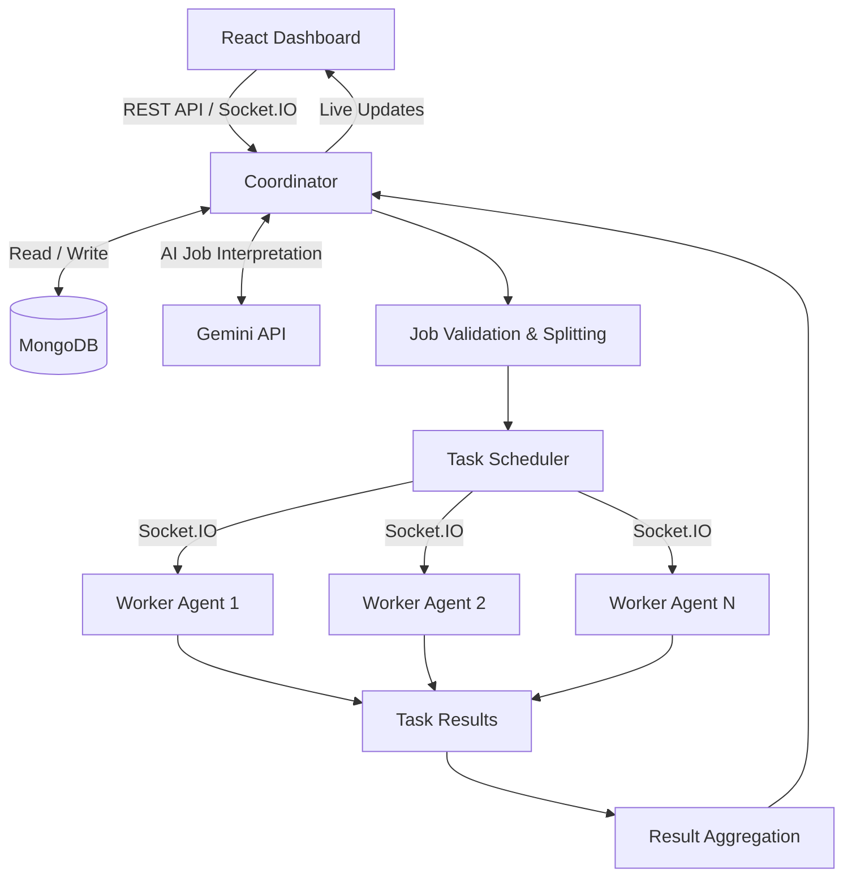

# MeshCompute AI

### One Job. Multiple Machines. Shared Computing Power.

MeshCompute AI is a distributed computing platform that connects multiple computers into a shared compute network. It takes computational workloads, breaks them into smaller tasks, distributes them across available machines, and combines their results.

The idea is simple: **instead of letting available CPU resources sit idle while someone else waits for a computation to finish, put those resources to work together.**

**HackCBS 9.0 | Open Innovation**

---

## The Problem

Computing power is expensive, but a surprising amount of it already exists and goes unused.

- Personal computers spend most of their time using only a fraction of their available CPU capacity.
- Computationally intensive workloads can take a considerable amount of time on a single machine.
- Scaling workloads through cloud infrastructure introduces additional costs and setup complexity.
- Most individuals and small teams cannot justify purchasing dedicated computing hardware for occasional heavy workloads.

We saw an opportunity to connect these two sides: people who have spare computing resources and people who need more computing power.

## Our Solution

MeshCompute AI turns independently available computers into a collaborative computing network.

It has two main participants:

**Resource Providers**

Run a lightweight Worker Agent on their computers and contribute available CPU resources to the network.

**Resource Consumers**

Submit computational jobs through a web dashboard and use the combined capacity of connected machines to execute them.

A central Coordinator manages the entire process. It validates jobs, splits them into smaller tasks, allocates those tasks to available workers, monitors execution, handles failures, and aggregates the results.

Users can also describe a computation in natural language. Our AI-assisted job compiler translates the request into a structured configuration that is validated before execution.

The goal is to make distributed computing accessible without requiring users to manage individual machines or manually distribute workloads.

---

## How It Works



### Execution Pipeline

1. **Job Submission:** A user submits a computational workload through the dashboard, either manually or using natural language.

2. **AI-Assisted Compilation:** Gemini interprets natural-language requests and generates a structured job configuration. A schema validator checks the generated configuration against supported workloads.

3. **Job Splitting:** The Coordinator divides the workload into smaller, independently executable tasks.

4. **Resource Allocation:** The Scheduler selects available workers based on their active task capacity and reported CPU load.

5. **Distributed Execution:** Worker Agents execute assigned tasks using Node.js worker threads, keeping their communication event loop responsive.

6. **Monitoring and Recovery:** Workers send periodic heartbeats. If a worker disconnects, eligible unfinished tasks can be reassigned to other available workers.

7. **Result Aggregation:** The Coordinator validates and combines partial results into the final output.

8. **Live Visualization:** The dashboard receives real-time updates about workers, task allocation, execution progress, and job completion.

---

## Key Features

### Distributed Computing
- Connect multiple independent computers through a central Coordinator.
- Execute computational workloads across multiple worker machines.
- Automatically divide jobs into smaller tasks.
- Aggregate partial results into a single output.

### AI-Assisted Job Compiler
- Convert natural-language requests into structured job configurations.
- Use Gemini API for job interpretation.
- Validate generated configurations before execution.
- Provide a rule-based fallback parser when the AI service is unavailable.

### Intelligent Task Scheduling
- Allocate tasks according to worker availability.
- Consider free task slots and reported CPU load.
- Distribute smaller tasks to support load balancing.
- Trigger scheduling when jobs are submitted, workers connect, or tasks complete.

### Fault Tolerance
- Periodic worker heartbeats.
- Automatic offline-worker detection.
- Reassignment of eligible interrupted tasks.
- Attempt-aware result handling to prevent stale or duplicate completions.
- Configurable retry limits.

### Real-Time Dashboard
- Monitor connected workers and their machine information.
- View CPU and available RAM metrics.
- Track individual task allocation and execution.
- Monitor job progress in real time.
- Access completed jobs and execution history.

---

## Supported Computational Workloads

The current implementation includes two computational workloads.

### 1. Matrix Multiplication

Distributed matrix multiplication divides the output rows of a matrix operation into smaller chunks.

For two matrices:

\[
C = A times B
\]

Different workers calculate different portions of the output matrix. The Coordinator collects the computed rows and reconstructs the final result.

The implementation uses deterministic integer matrices, making individual results straightforward to verify.

### 2. Monte Carlo Pi Estimation

Monte Carlo simulation estimates the value of Pi by generating random points inside a unit square and counting how many fall inside a quarter-circle.

Each worker receives a subset of the total samples.

The Coordinator combines the partial counts:

\[
\pi \approx 4 \times \frac{\sum \text{inside points}}{\sum \text{total points}}
\]

A seeded pseudo-random number generator makes individual task results reproducible.

---

## Technology Stack

| Component | Technologies |
|---|---|
| Frontend | React, Vite, Tailwind CSS |
| State Management | Zustand |
| Backend | Node.js, Express |
| Real-Time Communication | Socket.IO |
| Database | MongoDB, Mongoose |
| AI Integration | Google Gemini API |
| Validation | Zod |
| Authentication | JWT, bcryptjs |
| Parallel Execution | Node.js Worker Threads |
| Testing | Vitest |
| Architecture | Monorepo with npm Workspaces |

---

## Project Structure

```text
MeshCompute-AI/
│
├── coordinator/
│   └── src/
│       ├── config.js
│       ├── index.js
│       ├── middleware/
│       ├── models/
│       ├── routes/
│       ├── sockets/
│       ├── services/
│       │   ├── aiInterpreter.js
│       │   ├── aggregator.js
│       │   ├── baselineRunner.js
│       │   ├── heartbeatMonitor.js
│       │   ├── jobSplitter.js
│       │   └── scheduler.js
│       └── tests/
│
├── frontend/
│   └── src/
│       ├── components/
│       ├── pages/
│       ├── store/
│       └── lib/
│
├── worker-agent/
│   └── src/
│       ├── index.js
│       ├── sysinfo.js
│       ├── taskRunner.js
│       ├── workerThread.js
│       └── tasks/
│           ├── matrixMultiply.js
│           └── montecarloPi.js
│
├── shared/
│   └── constants.js
│
├── scripts/
│   ├── demo.js
│   └── seedDemoData.js
│
├── .env.example
├── package.json
└── README.md
```

---

## Getting Started

### Prerequisites

- Node.js 20 or later
- npm 9 or later
- MongoDB running locally or a MongoDB Atlas connection string
- Google Gemini API key (optional, for AI-powered job interpretation)

### 1. Clone the Repository

```bash
git clone <https://github.com/AuritroDeyKirty07/hackCBS9.0.git>
cd MeshCompute-AI
```

### 2. Install Dependencies

```bash
npm install
```

### 3. Configure Environment Variables

Create a `.env` file in the project root using the example configuration:

```bash
cp .env.example .env
```

Configure the following variables:

```env
# Coordinator
PORT=4000
MONGODB_URI=mongodb://localhost:27017/meshcompute
JWT_SECRET=your-secret-key
GEMINI_API_KEY=your-gemini-api-key

HEARTBEAT_INTERVAL_MS=3000
HEARTBEAT_TIMEOUT_MS=10000
TASK_TIMEOUT_MS=60000
MAX_SAMPLES_PER_JOB=2000000000
MAX_ATTEMPTS=3

# Worker
COORDINATOR_URL=http://localhost:4000
WORKER_TOKEN=meshcompute-demo-worker-token
WORKER_NAME=worker-1
MAX_CORES=4
MAX_CONCURRENT_TASKS=4
```

The compiler has a rule-based fallback when the API is unavailable.

### 4. Start the Application

Make sure MongoDB is running, then execute:

```bash
npm run demo
```

The demo script seeds demonstration data and starts the Coordinator, a local Worker Agent, and the frontend.

Open the dashboard:

```text
http://localhost:5173
```

Demo credentials:

```text
Email: demo@meshcompute.ai
Password: password123
```

### 5. Connect Additional Computers

One of the main ideas behind MeshCompute AI is that workers do not need to run on the same computer as the dashboard.

Start the Coordinator on a machine reachable by other computers on the network.

On another computer, clone the repository and install dependencies:

```bash
npm install
```

Configure its environment:

```env
COORDINATOR_URL=http://<COORDINATOR_IP>:4000
WORKER_TOKEN=<VALID_WORKER_TOKEN>
WORKER_NAME=worker-laptop-2
MAX_CORES=4
MAX_CONCURRENT_TASKS=4
```

Then start the Worker Agent:

```bash
npm run worker
```

Repeat this process for additional machines, using a unique worker name for each one.

Workers establish outbound connections to the Coordinator using Socket.IO. They do not need to expose their own inbound ports.

For machines outside the local network, the Coordinator must have a publicly reachable HTTPS/WSS endpoint.

---

## Running Individual Services

Instead of starting the complete demo, services can also be started separately.

**Backend Coordinator**

```bash
npm run dev:coordinator
```

**Frontend Dashboard**

```bash
npm run dev:frontend
```

**Worker Agent**

```bash
npm run worker
```

For a separately deployed frontend, configure:

```env
VITE_API_URL=http://localhost:4000/api
VITE_COORDINATOR_URL=http://localhost:4000
```

Replace the local URLs with the deployed Coordinator URL when deploying the frontend.

---

## Testing and Build

Run the Coordinator test suite:

```bash
npm test
```

Run Worker Agent tests:

```bash
npm -w worker-agent test
```

Build the frontend:

```bash
npm -w frontend run build
```

---

## Engineering Decisions

A few decisions were particularly important while building this system.

**1. Why a central Coordinator?**

A central Coordinator gives us one place to manage job states, worker availability, task allocation, and result aggregation. It also simplifies the initial implementation compared with building a peer-to-peer network.

**2. Why Socket.IO?**

Workers need to receive tasks and report results without repeatedly polling the server. Socket.IO provides persistent, bidirectional communication and allows the dashboard to receive live updates.

**3. Why Worker Threads?**

CPU-intensive computations can block the Node.js event loop. Running computation in worker threads allows the agent to continue sending heartbeats and handling communication while tasks execute.

**4. Why deterministic tasks?**

Reproducibility makes debugging and verification easier. It also helps prevent incorrect aggregation when tasks are retried.

**5. Why validate AI-generated configurations?**

An LLM should not be trusted to define executable workloads without restrictions. MeshCompute AI only accepts supported task types and validates their parameters before execution. It does not execute arbitrary AI-generated code.

---

## Current Limitations

MeshCompute AI is a working hackathon prototype, not yet a production-grade distributed computing marketplace.

Current limitations include:

- Only implemented and whitelisted workload types can be executed.
- The Coordinator remains a central dependency.
- Actual performance depends on worker hardware, network conditions, and workload size.
- Communication and scheduling overhead can outweigh the benefits of distribution for smaller jobs.
- Public deployment requires additional security hardening and worker isolation.
- The current worker execution model needs stronger sandboxing and resource controls before accepting untrusted workloads.

We believe being honest about these limitations is just as important as demonstrating what the system can do.

---

## What's Next?

There is plenty of room to take this further.

- Support additional workloads such as batch image processing and large-scale data transformations.
- Improve resource allocation using historical worker performance.
- Introduce stronger sandboxing and resource quotas.
- Build a more decentralized worker discovery and communication layer.
- Introduce transparent contribution accounting and verifiable computation.
- Improve benchmarking across different hardware configurations.

---

## The Bigger Picture

We don't believe every computational problem needs another expensive machine.

There are already millions of computers with processing capacity that goes unused every day. MeshCompute AI is an attempt to connect that existing capacity and make it useful.

Instead of thinking about computing power as something owned by a single machine, we want to explore what becomes possible when multiple machines work together.

**One Job. Multiple Machines. Shared Computing Power.**
